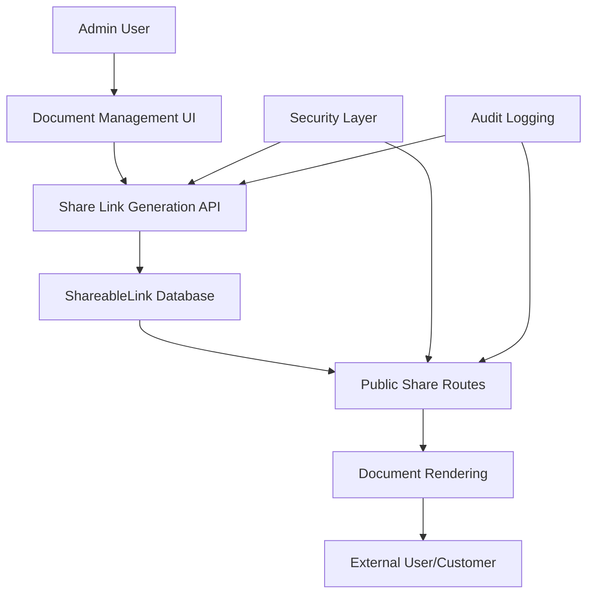

# Design Document

## Overview

The shareable document links feature enables the generation of secure, public URLs for billing statements, delivery receipts, and sales invoices. This system allows external users (primarily customers) to view these documents without authentication while maintaining security through cryptographically secure, time-limited tokens.

The feature integrates with the existing XGen MRP system's billing module and leverages the current database schema for BillingStatement, SalesInvoice, and DeliveryReceipt models. The implementation follows Next.js App Router patterns and maintains consistency with the existing codebase architecture.

## Architecture

### High-Level Architecture



### Database Schema Extension

The system requires a new `ShareableLink` model to track generated links:

```prisma
model ShareableLink {
  id              String            @id @default(cuid())
  token           String            @unique  // Cryptographically secure random token
  documentType    ShareableDocType  // BILLING_STATEMENT, SALES_INVOICE, DELIVERY_RECEIPT
  documentId      String            // ID of the referenced document
  
  // Security and lifecycle
  createdAt       DateTime          @default(now())
  expiresAt       DateTime          // Configurable expiration (default 30 days)
  isRevoked       Boolean           @default(false)
  revokedAt       DateTime?
  
  // Audit trail
  createdBy       String
  accessCount     Int               @default(0)
  lastAccessedAt  DateTime?
  lastAccessedIp  String?
  
  // Relationships
  createdByUser   User              @relation(fields: [createdBy], references: [id])
  
  @@index([token])
  @@index([documentType, documentId])
  @@index([expiresAt])
  @@index([isRevoked])
}

enum ShareableDocType {
  BILLING_STATEMENT
  SALES_INVOICE
  DELIVERY_RECEIPT
}
```

### URL Structure

The shareable URLs follow a consistent pattern:
- Billing Statements: `/billing-statement/share/{token}`
- Sales Invoices: `/sales-invoice/share/{token}`
- Delivery Receipts: `/delivery-receipt/share/{token}`

## Components and Interfaces

### 1. Share Link Management Components

#### ShareLinkButton Component
```typescript
interface ShareLinkButtonProps {
  documentType: 'billing-statement' | 'sales-invoice' | 'delivery-receipt';
  documentId: string;
  onLinkGenerated?: (link: string) => void;
}
```

#### ShareLinkManager Component
```typescript
interface ShareLinkManagerProps {
  documentType: ShareableDocType;
  documentId: string;
  existingLinks: ShareableLink[];
  onLinksUpdate: () => void;
}
```

### 2. Public Document Viewer Components

#### SharedDocumentLayout Component
```typescript
interface SharedDocumentLayoutProps {
  children: React.ReactNode;
  documentType: string;
  documentTitle: string;
  companyInfo: CompanyInfo;
}
```

#### DocumentNotFound Component
```typescript
interface DocumentNotFoundProps {
  reason: 'expired' | 'revoked' | 'not-found';
  contactInfo: ContactInfo;
}
```

### 3. API Interfaces

#### Share Link Generation API
```typescript
// POST /api/share-links
interface CreateShareLinkRequest {
  documentType: ShareableDocType;
  documentId: string;
  expirationDays?: number; // Optional, defaults to 30
}

interface CreateShareLinkResponse {
  success: boolean;
  shareableLink?: {
    id: string;
    token: string;
    url: string;
    expiresAt: string;
  };
  error?: string;
}
```

#### Share Link Management API
```typescript
// GET /api/share-links/{documentType}/{documentId}
interface GetShareLinksResponse {
  links: ShareableLink[];
}

// DELETE /api/share-links/{linkId}
interface RevokeShareLinkResponse {
  success: boolean;
  message: string;
}
```

#### Document Retrieval API
```typescript
// GET /api/shared-documents/{token}
interface SharedDocumentResponse {
  success: boolean;
  document?: {
    type: ShareableDocType;
    data: BillingStatement | SalesInvoice | DeliveryReceipt;
    metadata: {
      customerInfo: CustomerInfo;
      companyInfo: CompanyInfo;
    };
  };
  error?: string;
}
```

## Data Models

### ShareableLink Model
- **token**: 32-character cryptographically secure random string
- **documentType**: Enum defining the type of document being shared
- **documentId**: Foreign key to the actual document
- **expiresAt**: Configurable expiration timestamp
- **isRevoked**: Boolean flag for manual revocation
- **accessCount**: Track how many times the link has been accessed
- **auditFields**: Standard audit trail fields

### Document Data Transfer Objects

#### SharedBillingStatement
```typescript
interface SharedBillingStatement {
  id: string;
  statementNumber: string;
  customerName: string;
  billingDate: string;
  dueDate?: string;
  totalAmount: number;
  taxAmount: number;
  netAmount: number;
  status: string;
  notes?: string;
  // Related data
  customerOrder?: {
    orderNumber: string;
    orderDate: string;
  };
  deliveryReceipts: SharedDeliveryReceipt[];
  salesInvoice?: SharedSalesInvoice;
}
```

#### SharedSalesInvoice
```typescript
interface SharedSalesInvoice {
  id: string;
  invoiceNumber: string;
  invoiceDate: string;
  subtotal: number;
  taxAmount: number;
  totalAmount: number;
  paymentTerms?: string;
  dueDate?: string;
  status: string;
  invoiceItems: SalesInvoiceItem[];
}
```

#### SharedDeliveryReceipt
```typescript
interface SharedDeliveryReceipt {
  id: string;
  receiptNumber: string;
  deliveryDate: string;
  deliveryAddress: string;
  receivedBy: string;
  receivedByTitle?: string;
  deliveryStatus: string;
  deliveryNotes?: string;
  trackingNumber?: string;
  courierService?: string;
}
```

## Error Handling

### Error Types and Responses

1. **Link Not Found (404)**
   - Invalid or non-existent token
   - Display user-friendly message with contact information

2. **Link Expired (410)**
   - Token has passed expiration date
   - Provide option to request new link

3. **Link Revoked (403)**
   - Manually revoked by admin
   - Display appropriate message

4. **Document Not Found (404)**
   - Referenced document has been deleted
   - Log error for admin investigation

5. **Rate Limiting (429)**
   - Too many requests from same IP
   - Implement exponential backoff

### Error Handling Strategy

```typescript
interface ShareLinkError {
  code: 'NOT_FOUND' | 'EXPIRED' | 'REVOKED' | 'RATE_LIMITED' | 'SERVER_ERROR';
  message: string;
  userMessage: string;
  contactInfo?: ContactInfo;
  retryAfter?: number; // For rate limiting
}
```

## Testing Strategy

### Unit Tests
1. **Token Generation**
   - Verify cryptographic security of generated tokens
   - Test uniqueness across multiple generations
   - Validate token format and length

2. **Link Validation**
   - Test expiration logic
   - Verify revocation functionality
   - Test access counting

3. **Document Retrieval**
   - Test data transformation for each document type
   - Verify proper error handling for missing documents
   - Test audit logging functionality

### Integration Tests
1. **End-to-End Link Generation**
   - Create link from admin interface
   - Verify database persistence
   - Test link accessibility

2. **Document Viewing Flow**
   - Access shared link
   - Verify document rendering
   - Test print/download functionality

3. **Security Tests**
   - Test rate limiting
   - Verify token unpredictability
   - Test access logging

### Accessibility Tests
1. **Public Document Views**
   - Screen reader compatibility
   - Keyboard navigation
   - Color contrast compliance
   - Print accessibility

### Performance Tests
1. **Link Generation Performance**
   - Measure token generation time
   - Test concurrent link creation

2. **Document Loading Performance**
   - Measure document retrieval time
   - Test with large documents
   - Verify caching effectiveness

## Security Considerations

### Token Security
- Use `crypto.randomBytes(32)` for token generation
- Tokens are base64url encoded for URL safety
- No sequential or predictable patterns

### Access Control
- No authentication required for public links
- Rate limiting per IP address (10 requests per minute)
- Audit logging for all access attempts

### Data Exposure
- Only essential document data exposed
- No internal system information leaked
- Customer-specific data only (no cross-customer data)

### Link Management
- Default 30-day expiration
- Manual revocation capability
- Automatic cleanup of expired links

## Implementation Phases

### Phase 1: Database and Core API
- Add ShareableLink model to Prisma schema
- Implement share link generation API
- Create document retrieval API
- Add basic security measures

### Phase 2: Admin Interface Integration
- Add share buttons to existing document views
- Implement link management interface
- Add copy-to-clipboard functionality
- Integrate with existing admin layouts

### Phase 3: Public Document Views
- Create public route handlers
- Implement document rendering components
- Add print/download functionality
- Apply company branding

### Phase 4: Security and Monitoring
- Implement rate limiting
- Add comprehensive audit logging
- Create admin monitoring dashboard
- Add automated cleanup processes

## Configuration

### Environment Variables
```env
# Shareable Links Configuration
SHAREABLE_LINKS_DEFAULT_EXPIRY_DAYS=30
SHAREABLE_LINKS_MAX_PER_DOCUMENT=5
SHAREABLE_LINKS_RATE_LIMIT_PER_MINUTE=10

# Company Information for Shared Documents
COMPANY_NAME="XGen Manufacturing"
COMPANY_ADDRESS="123 Manufacturing St, Industrial City, IC 12345"
COMPANY_PHONE="+1 (555) 123-4567"
COMPANY_EMAIL="info@xgenmanufacturing.com"
```

### Feature Flags
- `ENABLE_SHAREABLE_LINKS`: Master toggle for the feature
- `ENABLE_LINK_ANALYTICS`: Toggle for detailed access analytics
- `ENABLE_AUTO_CLEANUP`: Toggle for automatic expired link cleanup