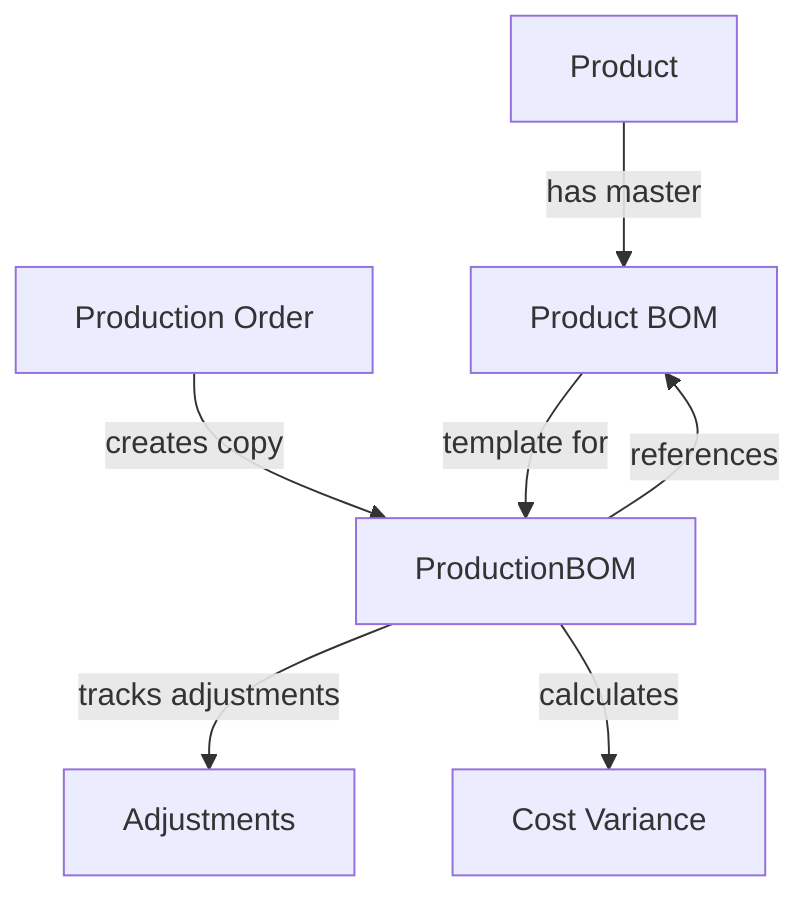

# ProductionBOM Implementation Guide

**Date:** 2024-12-19  
**Status:** ✅ IMPLEMENTED  
**Purpose:** Working copy BOM system for production orders

## Overview

The ProductionBOM system addresses a critical manufacturing need: **allowing production-specific adjustments to material quantities without affecting the master product BOM templates**. This creates a flexible, production-specific copy of the BOM that can be modified as needed during manufacturing.

## 🎯 **Problem Solved**

### **Before ProductionBOM:**
- Product BOMs serve as master templates
- Production orders reference these BOMs directly
- Any quantity adjustments during production affect the master template
- No way to track production-specific material changes
- Risk of corrupting the master BOM data

### **After ProductionBOM:**
- Product BOMs remain as pristine master templates
- Each production order gets its own working copy (ProductionBOM)
- Production-specific adjustments don't affect master BOMs
- Full traceability of changes and reasons
- Cost variance tracking between planned and actual

## 🏗️ **Database Schema**

### **ProductionBOM Model**
```prisma
model ProductionBOM {
  id                String   @id @default(cuid())
  productionOrderId String
  materialId        String
  originalBOMId     String? // Reference to the original BOM entry
  quantityNeeded    Decimal  @db.Decimal(10, 3)
  wastePercentage   Decimal  @db.Decimal(5, 2)
  adjustedQuantity  Decimal? @db.Decimal(10, 3) // Adjusted quantity for this production
  adjustmentReason  String? // Reason for quantity adjustment
  isAdjusted        Boolean  @default(false) // Flag to track if quantity was modified
  unitCost          Decimal  @db.Decimal(10, 4) // Cost at time of production
  totalCost         Decimal  @db.Decimal(12, 2) // Calculated total cost
  createdAt         DateTime @default(now())
  updatedAt         DateTime @updatedAt
  createdBy         String?
  modifiedBy        String?

  // Relations
  productionOrder ProductionOrder @relation(fields: [productionOrderId], references: [id], onDelete: Cascade)
  material        Material        @relation(fields: [materialId], references: [id])
  originalBOM     BOM?            @relation(fields: [originalBOMId], references: [id])

  @@unique([productionOrderId, materialId])
  @@index([productionOrderId])
  @@index([materialId])
  @@index([isAdjusted])
}
```

### **Key Features:**
- **Traceability**: Links back to original BOM entry
- **Flexibility**: Allows quantity adjustments with reasons
- **Cost Tracking**: Captures costs at production time
- **Audit Trail**: Tracks who made changes and when

## 🔄 **Workflow Process**

### **1. Production Order Creation**
```typescript
// When creating a production order
const productionOrder = await createProductionOrder({
  productId: "prod_123",
  quantity: 100,
  // ... other fields
})

// Automatically create ProductionBOM from product BOM
await createProductionBOMFromProduct({
  productionOrderId: productionOrder.id,
  productId: "prod_123",
  createdBy: session.user.id
})
```

### **2. Production BOM Creation Process**
1. **Fetch Product BOM**: Get master BOM for the product
2. **Calculate Quantities**: Multiply BOM quantities by production quantity
3. **Capture Costs**: Record current material costs
4. **Create Working Copy**: Insert ProductionBOM entries
5. **Update Production Order**: Set planned material cost

### **3. Production Adjustments**
```typescript
// Adjust individual material quantity
await adjustProductionBOMQuantity({
  id: "prod_bom_123",
  adjustedQuantity: 150, // Was 120, now 150
  adjustmentReason: "Extra material needed due to fabric defects",
  modifiedBy: session.user.id
})

// Bulk adjustments
await bulkAdjustProductionBOM({
  productionOrderId: "prod_order_123",
  adjustments: [
    {
      materialId: "mat_001",
      adjustedQuantity: 150,
      adjustmentReason: "Quality issues require extra material"
    },
    {
      materialId: "mat_002", 
      adjustedQuantity: 95,
      adjustmentReason: "Optimized cutting pattern"
    }
  ],
  modifiedBy: session.user.id
})
```

## 📊 **Data Relationships**



## 🎯 **Use Cases**

### **1. Material Quality Issues**
- **Scenario**: Received fabric has defects, need extra material
- **Action**: Adjust ProductionBOM quantity for affected materials
- **Benefit**: Master BOM stays accurate, production gets what it needs

### **2. Process Optimization**
- **Scenario**: Found more efficient cutting pattern, need less material
- **Action**: Reduce ProductionBOM quantities
- **Benefit**: Cost savings tracked, master BOM unchanged for future orders

### **3. Last-Minute Design Changes**
- **Scenario**: Customer requests design modification during production
- **Action**: Add/adjust materials in ProductionBOM
- **Benefit**: Change isolated to this production order only

### **4. Supplier Substitutions**
- **Scenario**: Primary material unavailable, substitute with different quantity
- **Action**: Update ProductionBOM with substitute material and quantity
- **Benefit**: Flexibility without affecting master template

## 🔧 **Server Actions Available**

### **Core Functions**
```typescript
// Create ProductionBOM from product BOM
createProductionBOMFromProduct(input: CreateProductionBOMFromProductInput)

// Get ProductionBOM for display
getProductionBOMForDisplay(productionOrderId: string)

// Adjust individual quantity
adjustProductionBOMQuantity(input: AdjustProductionBOMInput)

// Bulk adjust quantities
bulkAdjustProductionBOM(input: BulkAdjustProductionBOMInput)

// Get summary with analytics
getProductionBOMSummary(productionOrderId: string)

// Delete and reset
deleteProductionBOM(productionOrderId: string)
```

## 📈 **Analytics & Reporting**

### **Cost Variance Tracking**
```typescript
interface ProductionBOMSummary {
  productionOrderId: string
  totalEntries: number
  totalAdjusted: number
  originalTotalCost: number
  adjustedTotalCost: number
  costVariance: number
  costVariancePercentage: number
  entries: ProductionBOMForDisplay[]
}
```

### **Material Usage Analytics**
- **Adjustment Rate**: % of materials adjusted per production order
- **Cost Impact**: Financial impact of adjustments
- **Pattern Analysis**: Common adjustment reasons and materials
- **Stock Impact**: How adjustments affect inventory levels

## 🎨 **UI Components Needed**

### **1. ProductionBOM Manager**
- **Location**: `/admin/production/[id]/bom`
- **Features**:
  - View current ProductionBOM
  - Compare with original product BOM
  - Adjust quantities with reasons
  - Bulk edit capabilities
  - Cost variance display

### **2. BOM Comparison View**
```typescript
// Side-by-side comparison
interface BOMComparison {
  material: string
  originalBOM: { quantity: number, cost: number }
  productionBOM: { quantity: number, adjustedQuantity?: number, cost: number }
  variance: { quantity: number, cost: number, percentage: number }
}
```

### **3. Adjustment History**
- Track all changes made to ProductionBOM
- Show who made changes and when
- Display adjustment reasons
- Calculate cumulative impact

## 🔄 **Integration Points**

### **1. Production Order Flow**
```typescript
// In production order creation
export async function createProductionOrder(input: CreateProductionOrderInput) {
  // 1. Create production order
  const order = await createOrder(input)
  
  // 2. Create ProductionBOM from product BOM
  await createProductionBOMFromProduct({
    productionOrderId: order.id,
    productId: input.productId
  })
  
  return order
}
```

### **2. Material Reservation Integration**
```typescript
// Use ProductionBOM for material reservations instead of product BOM
const productionBOM = await getProductionBOM(productionOrderId)
await reserveMaterialsFromProductionBOM(productionBOM)
```

### **3. Cost Tracking Integration**
```typescript
// Update production order costs based on ProductionBOM changes
await updateProductionOrderMaterialCost(productionOrderId)
```

## 🚀 **Implementation Status**

### **✅ Completed**
- [x] Database schema and migrations
- [x] TypeScript type definitions
- [x] Server actions for CRUD operations
- [x] Cost calculation and variance tracking
- [x] Adjustment history and audit trail

### **🚧 Remaining Tasks**
- [ ] UI components for ProductionBOM management
- [ ] Integration with production order pages
- [ ] BOM comparison views
- [ ] Adjustment workflow UI
- [ ] Analytics dashboard
- [ ] Material reservation integration

## 💡 **Next Steps**

1. **Create UI Components**
   - ProductionBOM management interface
   - BOM comparison views
   - Adjustment dialogs

2. **Integrate with Existing Pages**
   - Add ProductionBOM tab to production order details
   - Update production creation flow
   - Add cost variance displays

3. **Enhanced Analytics**
   - ProductionBOM variance reports
   - Material adjustment patterns
   - Cost impact analysis

4. **Mobile Support**
   - Production floor adjustments
   - Quick quantity updates
   - Supervisor approvals

This ProductionBOM system provides the foundation for flexible, production-specific material management while maintaining the integrity of your master product BOMs. It's a crucial enhancement for real-world manufacturing operations! 