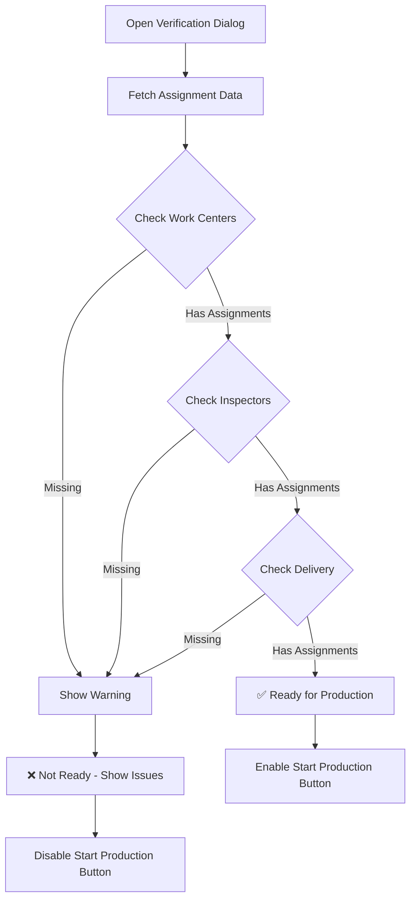

# Pre-Production Verification System

**Date:** January 2025  
**Status:** ✅ IMPLEMENTED  
**Focus:** Production Order Assignment Verification & Unified Role Coordination  

## Overview

The Pre-Production Verification System ensures that all necessary personnel are properly assigned before starting production orders. This system provides comprehensive visibility into work center assignments, inspector allocations, and delivery personnel assignments, preventing production delays and coordination issues.

## Key Features

### 🔍 **Pre-Production Verification Dialog**
- **Comprehensive Assignment Review**: Shows all assigned personnel across roles
- **Readiness Status Indicator**: Visual confirmation if production can start
- **Role-Specific Information**: Detailed view of each role's assignments and capabilities
- **Assignment Validation**: Identifies missing or incomplete assignments

### 📋 **Assignment Categories Displayed**

#### **Work Centers**
- Work center details (capacity, efficiency, status)
- Assigned workers with roles and responsibilities  
- Primary vs secondary assignments
- Operation schedules and assignments
- Contact information for each worker

#### **Quality Inspectors**
- Inspector specializations and certifications
- Years of experience
- Contact details
- Assignment type (quality checks vs operations)

#### **Delivery Personnel**
- Assigned delivery personnel
- Scheduled delivery dates
- Delivery addresses
- Special delivery notes and instructions

### ⚠️ **Validation & Warnings**
- **Missing Work Center Assignments**: Alerts when no workers assigned
- **No Inspector Assignment**: Warns about quality control risks
- **Missing Delivery Personnel**: Flags delivery coordination issues
- **Comprehensive Readiness Check**: Overall production readiness status

## Implementation Details

### **New Server Action**
```typescript
// src/lib/actions/production-order.ts
export async function getProductionOrderWithAssignments(id: string)
```
- Fetches production order with comprehensive assignment data
- Includes work center user assignments (both models)
- Gets inspector assignments through quality checks and operations
- Retrieves delivery assignments with user details

### **New UI Component**
```typescript
// src/components/module/admin/production/pre-production-verification-dialog.tsx
export const PreProductionVerificationDialog
```
- Large modal dialog with scrollable content
- Organized sections for each role category
- User cards with contact information and role details
- Readiness status with specific issue identification
- Integration with production start functionality

### **Row Actions Integration**
- Added "Verify & Start" option to production order actions
- Only visible for PENDING production orders
- Seamless integration with existing action menu
- Proper state management and error handling

## User Workflow

### **Admin Production Order Management**
1. **View Production Orders**: Admin sees list of all production orders
2. **Select Action**: Click action menu for a PENDING production order
3. **Choose "Verify & Start"**: Opens pre-production verification dialog
4. **Review Assignments**: 
   - Check work center assignments
   - Verify inspector allocations
   - Confirm delivery personnel
5. **Readiness Assessment**: System shows overall readiness status
6. **Start Production**: If ready, click "Start Production" button
7. **Handle Issues**: If not ready, address missing assignments first

### **Assignment Validation Process**


## Technical Architecture

### **Data Structure**
```typescript
interface AssignmentData {
  productionOrder: ProductionOrder & {
    product: Product
    productVariant?: ProductVariant
    customerOrder?: CustomerOrder
  }
  workCenters: WorkCenterWithAssignments[]
  inspectors: InspectorWithDetails[]
  delivery: DeliveryAssignmentWithUser | null
}
```

### **Work Center Assignment Models**
The system handles both assignment models:
- **WorkCenterAssignment**: Newer model with primary/secondary roles
- **UserWorkCenter**: Legacy model with responsible/member roles

### **Inspector Assignment Sources**
Inspectors can be assigned through:
- **Quality Checks**: Direct inspector assignments
- **Operations**: Inspectors assigned to specific operations

### **Delivery Integration**
- **DeliveryAssignment**: Direct delivery personnel assignment
- **Scheduled Dates**: Planned delivery timelines
- **Address Management**: Delivery location tracking

## Benefits

### **For Administrators**
- ✅ **Complete Visibility**: See all assignments at a glance
- ✅ **Risk Mitigation**: Identify issues before production starts
- ✅ **Coordination Improvement**: Better role coordination
- ✅ **Quality Assurance**: Ensure proper inspector assignment

### **For Production Teams**
- ✅ **Clear Expectations**: Know who's assigned to what
- ✅ **Contact Information**: Easy access to team member details
- ✅ **Role Clarity**: Understand responsibilities and hierarchies
- ✅ **Reduced Delays**: Prevent production delays from missing assignments

### **For Inspectors**
- ✅ **Assignment Transparency**: Clear view of their responsibilities
- ✅ **Specialization Matching**: Assignments match their expertise
- ✅ **Preparation Time**: Advance notice of upcoming inspections

### **For Delivery Personnel**
- ✅ **Delivery Planning**: Clear delivery schedules and requirements
- ✅ **Address Visibility**: Access to delivery locations
- ✅ **Production Coordination**: Alignment with production completion

## Future Enhancements

### **Assignment Management**
- **Direct Assignment**: Assign personnel directly from verification dialog
- **Assignment Templates**: Save common assignment patterns
- **Automatic Assignment**: AI-powered assignment suggestions

### **Notification System**
- **Assignment Alerts**: Notify personnel of new assignments
- **Readiness Notifications**: Alert when production can start
- **Issue Notifications**: Warn about missing assignments

### **Integration Improvements**
- **Calendar Integration**: Sync with personnel calendars
- **Capacity Management**: Check personnel availability
- **Skill Matching**: Match assignments to personnel skills

### **Reporting & Analytics**
- **Assignment Reports**: Track assignment patterns
- **Readiness Metrics**: Monitor verification effectiveness
- **Performance Analysis**: Analyze assignment impact on production

## Error Handling

### **Missing Data Scenarios**
- **No Work Centers**: Clear error message and guidance
- **No Inspectors**: Quality control warning with options
- **No Delivery**: Delivery coordination alert
- **Invalid Assignments**: Data validation and error recovery

### **System Integration**
- **Database Errors**: Graceful error handling and user feedback
- **Permission Issues**: Role-based access control
- **Network Issues**: Retry mechanisms and offline handling

## Testing Scenarios

### **Assignment Completeness**
- ✅ All assignments present
- ⚠️ Missing work center assignments
- ⚠️ Missing inspector assignments
- ⚠️ Missing delivery assignments
- ⚠️ Multiple missing assignments

### **Role Combinations**
- Different work center assignment types
- Various inspector specializations
- Different delivery scenarios
- Mixed assignment states

### **Production Order States**
- PENDING orders (should show verification)
- IN_PROGRESS orders (verification not needed)
- COMPLETED orders (verification not applicable)

## Conclusion

The Pre-Production Verification System significantly enhances production order management by providing comprehensive visibility into personnel assignments before production begins. This proactive approach reduces delays, improves coordination, and ensures quality standards are maintained throughout the production process.

The system successfully unifies the role-based logic requested, providing a clear view of who is assigned to what, their capabilities, and contact information - all in a single, user-friendly interface that guides administrators through the verification process before starting production. 