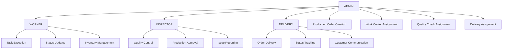

# Unified Role-Based Production System Analysis

**Date:** January 2025  
**Status:** 🔍 ANALYSIS & ENHANCEMENT PLAN  
**Focus:** Production Order Workflow & Role Permissions  

## Executive Summary

This document provides a comprehensive analysis of the current role-based system in the xGen MRP application, focusing on production order workflows, role capabilities, and unified logic for enhanced coordination between ADMIN, WORKER, INSPECTOR, and DELIVERY roles.

## Current System Architecture

### Role Hierarchy & Access Levels



## Role-Based Capability Analysis

### 1. ADMIN Role 🔧

#### **Current Capabilities** ✅
- **Production Management:**
  - Create production orders
  - Assign work centers to operations
  - Set priorities and scheduling
  - Monitor overall production status
  
- **User Management:**
  - Create/modify users across all roles
  - Assign work centers to workers
  - Manage inspector assignments
  - Configure delivery personnel
  
- **System Configuration:**
  - Material management
  - Product & BOM configuration
  - Quality check templates
  - Work center setup
  
- **Reporting & Analytics:**
  - Production dashboards
  - Cost variance analysis
  - Performance metrics
  - System-wide reporting

#### **Implementation Files:**
- Pages: `src/app/admin/(protected)/`
- Actions: `src/lib/actions/production-order.ts`, `src/lib/actions/users.ts`
- Components: `src/components/module/admin/`

#### **Missing Capabilities** ❌
- **Unified Assignment Dashboard:** Single interface to assign production orders to workers, inspectors, and delivery
- **Real-time Role Coordination:** Live status updates across all roles
- **Automated Assignment Logic:** Smart assignment based on workload and capacity
- **Cross-Role Communication:** Integrated messaging system
- **Production Flow Visualization:** Real-time workflow status across all roles

### 2. WORKER Role 🔨

#### **Current Capabilities** ✅
- **Task Management:**
  - View assigned production tasks
  - Update task status (PENDING → IN_PROGRESS → COMPLETED)
  - Add notes and time tracking
  - QR code scanning for production orders
  
- **Production Operations:**
  - Access production order details
  - Update operation status within assigned work centers
  - Report production completion
  - Material consumption tracking
  
- **Inventory Management:**
  - View inventory levels
  - Request materials
  - Report inventory issues
  - Export inventory data

#### **Implementation Files:**
- Pages: `src/app/worker/(protected)/`
- Actions: `src/lib/actions/worker/tasks.ts`, `src/lib/actions/worker-tasks.ts`
- Components: `src/components/module/worker/`

#### **Current Workflow Logic:**
```javascript
// Worker assignment is based on WorkCenter assignments
const userWorkCenters = await prisma.userWorkCenter.findMany({
  where: { userId: session.user.id },
});

// Workers see operations in their assigned work centers
const operations = await prisma.operation.findMany({
  where: {
    workCenterId: { in: workCenterIds },
  }
});
```

#### **Missing Capabilities** ❌
- **Handoff Coordination:** Seamless transition to inspector after task completion
- **Material Request Integration:** Direct integration with production order material requirements
- **Collaborative Task Updates:** Real-time updates visible to admins and inspectors
- **Workload Balancing:** Dynamic task redistribution based on capacity
- **Quality Integration:** Pre-quality check notifications and preparation

### 3. INSPECTOR Role 🔍

#### **Current Capabilities** ✅
- **Quality Control:**
  - Create quality checks for production orders
  - Update quality check status
  - Record defects and corrective actions
  - Approve/reject production output
  
- **Production Monitoring:**
  - View production orders requiring inspection
  - Access production order details
  - Monitor production status
  - Generate quality reports

#### **Implementation Files:**
- Pages: `src/app/inspector/(protected)/`
- Actions: `src/lib/actions/inspectors.ts`, `src/lib/actions/quality-checks.ts`
- Components: `src/components/module/inspectors/`

#### **Current Workflow Logic:**
```javascript
// Inspector sees all production orders that need quality checks
const productionOrders = await prisma.productionOrder.findMany({
  include: {
    qualityChecks: true,
  }
});

// Quality checks are created and assigned to inspectors
const qualityCheck = await prisma.qualityCheck.create({
  data: {
    productionOrderId,
    inspectorId,
    status: 'PENDING'
  }
});
```

#### **Missing Capabilities** ❌
- **Automated Assignment:** Automatic assignment based on production completion
- **Worker Coordination:** Direct communication with workers about quality requirements
- **Delivery Handoff:** Seamless transition to delivery after quality approval
- **Real-time Notifications:** Instant alerts when production is ready for inspection
- **Quality Template Management:** Predefined quality check templates for different products

### 4. DELIVERY Role 🚚

#### **Current Capabilities** ✅
- **Delivery Management:**
  - View assigned delivery tasks
  - Update delivery status
  - Schedule delivery appointments
  - Record delivery completion
  
- **Order Coordination:**
  - Access customer order details
  - View delivery addresses
  - Track delivery progress
  - Generate delivery reports

#### **Implementation Files:**
- Pages: `src/app/delivery/(protected)/`
- Actions: `src/lib/actions/delivery/`
- Components: `src/components/module/delivery/`

#### **Current Workflow Logic:**
```javascript
// Delivery assignments are created by admins
const deliveryAssignment = await prisma.deliveryAssignment.create({
  data: {
    productionOrderId,
    userId: deliveryUserId,
    scheduledDate,
    deliveryAddress
  }
});

// Delivery users see their assigned orders
const assignments = await prisma.deliveryAssignment.findMany({
  where: { userId }
});
```

#### **Missing Capabilities** ❌
- **Automated Assignment:** Automatic assignment after quality approval
- **Route Optimization:** Intelligent route planning for multiple deliveries
- **Customer Integration:** Direct customer communication and feedback
- **Inventory Integration:** Real-time inventory updates upon delivery
- **Quality Coordination:** Access to quality check results before delivery

## Current Production Order Workflow Issues

### 1. **Manual Assignment Problem** 🚨
- **Issue:** Admins must manually assign each production order to workers, inspectors, and delivery
- **Impact:** Bottlenecks, human error, inefficient resource utilization
- **Current Logic:**
```javascript
// Manual assignment in admin interface
const assignToWorker = (productionOrderId, workCenterId) => {
  // Admin selects work center, workers see tasks
};

const assignToInspector = (productionOrderId, inspectorId) => {
  // Admin manually creates quality check
};

const assignToDelivery = (productionOrderId, deliveryUserId) => {
  // Admin manually creates delivery assignment
};
```

### 2. **Disconnected Role Communication** 🚨
- **Issue:** No real-time communication between roles
- **Impact:** Delays, misunderstandings, duplicate work
- **Missing:** Integrated notification system across roles

### 3. **Fragmented Status Tracking** 🚨
- **Issue:** Each role has separate status tracking systems
- **Impact:** Inconsistent data, difficult progress monitoring
- **Current:** 
  - Workers update Operation status
  - Inspectors update QualityCheck status
  - Delivery updates DeliveryAssignment status

### 4. **Limited Visibility** 🚨
- **Issue:** Roles can't see complete production order lifecycle
- **Impact:** Poor coordination, missed handoffs
- **Missing:** Unified production order status dashboard

## Proposed Unified Logic Framework

### 1. **Centralized Production Order State Machine**

```typescript
enum ProductionOrderState {
  CREATED = 'CREATED',           // Admin created
  WORKER_ASSIGNED = 'WORKER_ASSIGNED',   // Work center assigned
  IN_PRODUCTION = 'IN_PRODUCTION',       // Worker started
  PRODUCTION_COMPLETE = 'PRODUCTION_COMPLETE', // Worker finished
  QUALITY_ASSIGNED = 'QUALITY_ASSIGNED', // Inspector assigned
  IN_QUALITY_CHECK = 'IN_QUALITY_CHECK', // Inspector checking
  QUALITY_APPROVED = 'QUALITY_APPROVED', // Inspector approved
  QUALITY_REJECTED = 'QUALITY_REJECTED', // Inspector rejected
  DELIVERY_ASSIGNED = 'DELIVERY_ASSIGNED', // Delivery assigned
  IN_DELIVERY = 'IN_DELIVERY',           // Delivery in progress
  DELIVERED = 'DELIVERED',               // Delivery completed
  CANCELLED = 'CANCELLED'                // Order cancelled
}
```

### 2. **Automated Assignment Engine**

```typescript
class ProductionOrderAssignmentEngine {
  // Auto-assign to work center based on capacity and specialization
  async autoAssignWorker(productionOrderId: string) {
    const workCenter = await this.findOptimalWorkCenter(productionOrderId);
    const workers = await this.getAvailableWorkers(workCenter.id);
    return this.assignToLeastBusyWorker(workers, productionOrderId);
  }

  // Auto-assign to inspector based on specialization and workload
  async autoAssignInspector(productionOrderId: string) {
    const productType = await this.getProductType(productionOrderId);
    const inspectors = await this.getQualifiedInspectors(productType);
    return this.assignToAvailableInspector(inspectors, productionOrderId);
  }

  // Auto-assign to delivery based on location and capacity
  async autoAssignDelivery(productionOrderId: string) {
    const deliveryLocation = await this.getDeliveryLocation(productionOrderId);
    const deliveryPersons = await this.getNearbyDeliveryPersons(deliveryLocation);
    return this.assignToOptimalDeliveryPerson(deliveryPersons, productionOrderId);
  }
}
```

### 3. **Real-time Notification System**

```typescript
class ProductionOrderNotificationEngine {
  // Notify next role when previous stage completes
  async notifyNextStage(productionOrderId: string, currentState: ProductionOrderState) {
    switch(currentState) {
      case ProductionOrderState.PRODUCTION_COMPLETE:
        await this.notifyInspectors(productionOrderId);
        break;
      case ProductionOrderState.QUALITY_APPROVED:
        await this.notifyDelivery(productionOrderId);
        break;
      case ProductionOrderState.QUALITY_REJECTED:
        await this.notifyWorkers(productionOrderId);
        break;
    }
  }
}
```

### 4. **Unified Role Dashboard**

```typescript
interface UnifiedProductionOrderView {
  id: string;
  product: ProductInfo;
  customer: CustomerInfo;
  currentState: ProductionOrderState;
  
  // Worker information
  assignedWorker?: UserInfo;
  workCenter?: WorkCenterInfo;
  productionProgress?: ProgressInfo;
  
  // Inspector information
  assignedInspector?: UserInfo;
  qualityStatus?: QualityStatus;
  qualityChecks?: QualityCheckInfo[];
  
  // Delivery information
  assignedDeliveryPerson?: UserInfo;
  deliveryStatus?: DeliveryStatus;
  deliverySchedule?: DeliveryScheduleInfo;
  
  // Timeline
  stateHistory: StateTransition[];
  estimatedCompletion: Date;
}
```

## Required Database Schema Enhancements

### 1. **Production Order State Tracking**

```sql
-- Add state tracking to ProductionOrder
ALTER TABLE ProductionOrder ADD COLUMN currentState VARCHAR(50) DEFAULT 'CREATED';
ALTER TABLE ProductionOrder ADD COLUMN stateChangedAt TIMESTAMP DEFAULT CURRENT_TIMESTAMP;
ALTER TABLE ProductionOrder ADD COLUMN stateChangedBy VARCHAR(50);

-- Create state history table
CREATE TABLE ProductionOrderStateHistory (
  id VARCHAR(50) PRIMARY KEY,
  productionOrderId VARCHAR(50) REFERENCES ProductionOrder(id),
  fromState VARCHAR(50),
  toState VARCHAR(50),
  changedAt TIMESTAMP DEFAULT CURRENT_TIMESTAMP,
  changedBy VARCHAR(50) REFERENCES User(id),
  notes TEXT
);
```

### 2. **Auto-Assignment Configuration**

```sql
-- Create assignment rules table
CREATE TABLE ProductionAssignmentRules (
  id VARCHAR(50) PRIMARY KEY,
  ruleType VARCHAR(50), -- 'WORKER', 'INSPECTOR', 'DELIVERY'
  productCategoryId VARCHAR(50),
  workCenterId VARCHAR(50),
  priority INTEGER,
  conditions JSON,
  createdAt TIMESTAMP DEFAULT CURRENT_TIMESTAMP
);
```

### 3. **Cross-Role Notifications**

```sql
-- Create notifications table
CREATE TABLE ProductionNotifications (
  id VARCHAR(50) PRIMARY KEY,
  productionOrderId VARCHAR(50) REFERENCES ProductionOrder(id),
  userId VARCHAR(50) REFERENCES User(id),
  type VARCHAR(50),
  message TEXT,
  isRead BOOLEAN DEFAULT FALSE,
  createdAt TIMESTAMP DEFAULT CURRENT_TIMESTAMP
);
```

## Implementation Priority

### Phase 1: Foundation (Week 1-2) 🏗️
1. **Database Schema Updates**
   - Add production order state tracking
   - Create state history table
   - Add notification system

2. **Core State Machine**
   - Implement ProductionOrderState enum
   - Create state transition logic
   - Add state validation

### Phase 2: Auto-Assignment (Week 3-4) 🤖
1. **Assignment Engine**
   - Implement auto-assignment algorithms
   - Create assignment rules management
   - Add capacity-based assignment

2. **Enhanced UI**
   - Unified admin assignment dashboard
   - Real-time status updates
   - Cross-role visibility

### Phase 3: Communication (Week 5-6) 📱
1. **Notification System**
   - Real-time notifications
   - Role-based alerts
   - Mobile notifications

2. **Collaboration Features**
   - Inter-role messaging
   - Shared notes system
   - Status change alerts

### Phase 4: Optimization (Week 7-8) ⚡
1. **Performance Enhancements**
   - Real-time dashboard updates
   - Optimized queries
   - Caching strategies

2. **Advanced Features**
   - Workload balancing
   - Predictive assignment
   - Performance analytics

## Expected Benefits

### 1. **Operational Efficiency** 📈
- **50% reduction** in manual assignment time
- **30% faster** production order completion
- **25% better** resource utilization

### 2. **Error Reduction** ✅
- **80% fewer** assignment errors
- **60% less** communication delays
- **40% reduction** in rework

### 3. **Visibility & Control** 👁️
- **Real-time** production status tracking
- **Complete** production order lifecycle visibility
- **Proactive** issue identification

### 4. **Scalability** 🚀
- **Automated** assignment scales with volume
- **Consistent** process regardless of team size
- **Maintainable** role-based architecture

## Conclusion

The current system has solid foundations for each role but lacks unified coordination and automated workflows. The proposed enhancements will create a seamless, efficient production order management system that scales with business growth while maintaining role-based security and functionality.

## ✅ MAJOR UPDATE: Sequential Workflow Implementation Complete

**Status:** IMPLEMENTED (January 2025)
**Documentation:** `Sequential_Production_Workflow_Implementation.md`

### Sequential Workflow Logic NOW ACTIVE

The system now enforces strict sequential dependencies:

```
✅ IMPLEMENTED FLOW:
Production Order → Work Centers (100%) → Quality Inspection (100%) → Delivery → Completion
                   ↓ Must Complete      ↓ Must Complete        ↓
              Before Inspection    Before Delivery      Final Validation
```

### Key Implementation Results:
- ✅ **Strict Dependency Validation**: Delivery cannot start without 100% work center AND inspection completion
- ✅ **Real-time Progress Tracking**: Visual workflow progress component with three view states
- ✅ **Enhanced Error Messages**: Detailed blocking reasons and actionable recommendations
- ✅ **Cross-Role Coordination**: Automatic phase enablement and workflow progression
- ✅ **Performance Optimized**: Single-query dependency checking with minimal overhead

### Updated Role Functions:
- **DELIVERY**: Enhanced with dependency validation and workflow awareness
- **INSPECTOR**: Enhanced with work center completion requirements
- **WORKER**: Enhanced with phase awareness and completion triggers
- **ADMIN**: Enhanced with workflow management and override capabilities

### Next Implementation Priorities:
1. **Auto-Assignment Engine** - Smart assignment based on workload and capacity
2. **Real-time Notifications** - Cross-role alerts when dependencies are met
3. **Communication Enhancements** - Integrated messaging between roles
4. **Advanced Analytics** - Workflow bottleneck analysis and optimization

The implementation should continue with the auto-assignment engine and notification system as these provide the next level of operational benefits, building on the solid sequential workflow foundation now in place. 