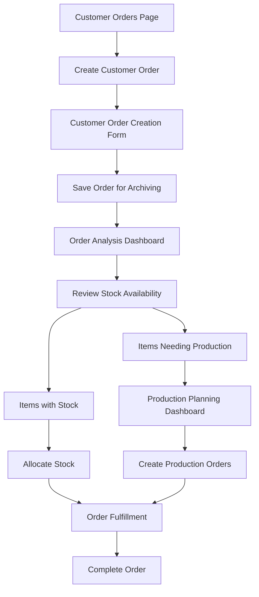

# Product Requirements Document (PRD)
## Customer Order & Production Planning Decoupling

**Document Version**: 2.0  
**Date**: January 7, 2025  
**Author**: System Analysis  
**Priority**: High  

---

## 🎯 Executive Summary

The current system incorrectly unifies customer order creation with production planning in a single form (`/admin/production/create`). This creates the exact workflow complexity the client wanted to avoid. We need to create **separate, independent workflows** for customer order creation and production planning while maintaining a unified UI design.

---

## ❌ Current Problem Statement

### **Core Issues:**
1. **❌ WRONG UNIFICATION**: Customer orders are created through the production create form (`/admin/production/create`)
2. **❌ MIXED WORKFLOWS**: Production planning is forced during customer order creation
3. **❌ NO INDEPENDENT ORDER CREATION**: No dedicated customer order creation form
4. **❌ ARCHIVING COMPROMISED**: Orders are created with production dependencies
5. **❌ CLIENT REQUIREMENT MISUNDERSTOOD**: "Unified" meant consistent UI design, not mixed functionality

### **Current Architecture (WRONG):**
```
Customer Orders Page → "Create Order" Button → Production Create Form
Production Create Form → Choose: "Standalone" or "Customer Order"
If "Customer Order" → Create Order + Production Planning (MIXED)
If "Standalone" → Just Production Order
```

### **Client's Actual Need:**
```
Customer Orders Page → "Create Customer Order" Button → Customer Order Form
Customer Order Form → Save Order for Archiving (INDEPENDENT)
Order Analysis Page → Review Stock vs Production Needs
Production Planning Page → Create Production Orders (SEPARATE)
```

### **Real-World Scenario:**
```
Customer Order #CO-2024-0001:
├── Item 1 (Shirt Size M): ✅ Stock Available (50 units, need 10)
├── Item 2 (Pants Size L): ✅ Stock Available (30 units, need 5)  
├── Item 3 (Jacket Size XL): ❌ Needs Production (0 units, need 15)
└── Item 4 (Hat): ✅ Stock Available (100 units, need 20)

Current System: Forces production planning during order creation
Client Need: Create order independently, then analyze and plan production separately
```

---

## ✅ Corrected Solution

### **Proper Workflow Architecture:**



### **Key Features:**
1. **Independent Customer Order Creation**: Dedicated form for customer orders only
2. **Separate Production Planning**: Production decisions made after order analysis
3. **Unified UI Design**: Consistent look and feel across all forms
4. **Complete Order Archiving**: Orders saved independently without production dependencies
5. **Flexible Analysis**: Stock analysis and production planning as separate processes

---

## 📋 Revised Implementation Plan

### **Phase 1: Separate Customer Order Creation (3-4 days)**

#### **Task 1.1: Create Dedicated Customer Order Form**
**New File:** `/src/app/admin/(protected)/customer-orders/create/page.tsx`
**New Component:** `/src/components/module/admin/customer-orders/create/CustomerOrderCreateClient.tsx`

**Features:**
- Customer selection
- Product/variant selection
- Quantity and pricing
- Order notes and requirements
- **NO production planning integration**

#### **Task 1.2: Update Customer Orders Page**
**File:** `/src/app/admin/(protected)/customer-orders/page.tsx`

**Changes:**
- Update "Create Order" button to point to `/admin/customer-orders/create`
- Remove link to production create form
- Add proper navigation to customer order creation

#### **Task 1.3: Customer Order Creation Actions**
**File:** `/src/lib/actions/customer-order.ts`

**Enhancements:**
- Ensure `createCustomerOrder()` creates orders independently
- Remove any production order creation logic
- Focus on order archiving and data integrity

### **Phase 2: Production Planning Separation (4-5 days)**

#### **Task 2.1: Refactor Production Create Form**
**File:** `/src/components/module/admin/production/create/ProductionCreateClient.tsx`

**Changes:**
- Remove customer order creation functionality
- Focus only on standalone production orders
- Remove "From Customer Order" source option
- Simplify to production-only workflow

#### **Task 2.2: Update Production Create Page**
**File:** `/src/app/admin/(protected)/production/create/page.tsx`

**Changes:**
- Remove customer order data fetching
- Update metadata and descriptions
- Focus on production order creation only

#### **Task 2.3: Production Planning Dashboard Enhancement**
**File:** `/src/app/admin/(protected)/production/planning/page.tsx`

**Enhancements:**
- Make this the primary interface for production planning
- Support batch production order creation from customer order analysis
- Link to customer order analysis results

### **Phase 3: Order Analysis Integration (3-4 days)**

#### **Task 3.1: Customer Order Analysis Workflow**
**File:** `/src/app/admin/(protected)/customer-orders/[id]/analyze/page.tsx`

**Enhancements:**
- Make this the bridge between customer orders and production planning
- Provide clear navigation to production planning
- Support stock allocation for available items

#### **Task 3.2: Analysis to Production Planning Flow**
**New Component:** `/src/components/module/admin/customer-orders/analysis/ProductionPlanningActions.tsx`

**Features:**
- "Create Production Orders" button
- "Allocate Stock" button
- Navigation to production planning dashboard
- Batch production order creation

### **Phase 4: UI/UX Consistency (2-3 days)**

#### **Task 4.1: Unified Design System**
**Files:** Multiple component files

**Goals:**
- Consistent form layouts across customer order and production creation
- Unified button styles and navigation patterns
- Consistent card layouts and spacing
- Shared validation and error handling patterns

#### **Task 4.2: Navigation and Workflow Clarity**
**Files:** Multiple page files

**Enhancements:**
- Clear breadcrumb navigation
- Consistent page headers and descriptions
- Proper back navigation between workflows
- Clear workflow progression indicators

---

## 🔄 Migration Strategy

### **Database Migration:**
1. No schema changes required (existing structure supports separation)
2. Ensure existing customer orders remain intact
3. Update any production order references to maintain relationships

### **Rollback Plan:**
1. Maintain existing production create form as backup
2. Feature flags for new customer order creation
3. Gradual migration of existing workflows

---

## ✅ Success Criteria

### **Functional Requirements:**
- ✅ Customer orders can be created independently without production planning
- ✅ Production planning is a separate, optional workflow
- ✅ Orders are saved for archiving purposes immediately upon creation
- ✅ Stock analysis and production planning are separate processes
- ✅ Mixed fulfillment scenarios supported through separate workflows
- ✅ Unified UI design across all forms

### **User Experience Requirements:**
- ✅ Clear separation between customer order creation and production planning
- ✅ Intuitive navigation between workflows
- ✅ Consistent form design and user interactions
- ✅ No confusion about when to use which form
- ✅ Streamlined workflow for each process

### **Business Requirements:**
- ✅ Complete order archiving maintained
- ✅ Flexible production planning based on actual needs
- ✅ Support for mixed fulfillment scenarios
- ✅ No forced production planning during order creation

---

## 📊 Implementation Timeline

| Phase | Duration | Tasks | Dependencies |
|-------|----------|-------|--------------|
| Phase 1 | 3-4 days | Separate Customer Order Creation | None |
| Phase 2 | 4-5 days | Production Planning Separation | Phase 1 |
| Phase 3 | 3-4 days | Order Analysis Integration | Phase 1-2 |
| Phase 4 | 2-3 days | UI/UX Consistency | Phase 1-3 |

**Total Estimated Time**: 12-16 working days (2.5-3 weeks)

---

## 🚨 Risk Assessment

### **High Risk:**
- User confusion during transition period
- Existing workflow disruption
- Data consistency during migration

### **Medium Risk:**
- UI/UX consistency challenges
- Navigation complexity
- User adoption of new workflows

### **Mitigation Strategies:**
- Comprehensive user training
- Clear documentation of new workflows
- Gradual rollout with feature flags
- User feedback collection and iteration

---

## 📝 Key Insights

### **Why Previous Implementation Failed:**
1. **Misunderstood "Unified"**: Thought it meant combining functionality, not consistent design
2. **Over-engineering**: Tried to solve multiple problems in one form
3. **Workflow Confusion**: Mixed customer order creation with production planning
4. **Client Requirement Misinterpretation**: Focused on technical unification instead of business workflow separation

### **Correct Understanding:**
- **"Unified"** = Consistent UI design and user experience
- **"Separate"** = Independent workflows for different business processes
- **"Flexible"** = Production planning only when needed, not forced

---

**Document Status**: ✅ Revised for Correct Implementation  
**Approval Required**: Client & Development Team  
**Last Updated**: January 7, 2025
