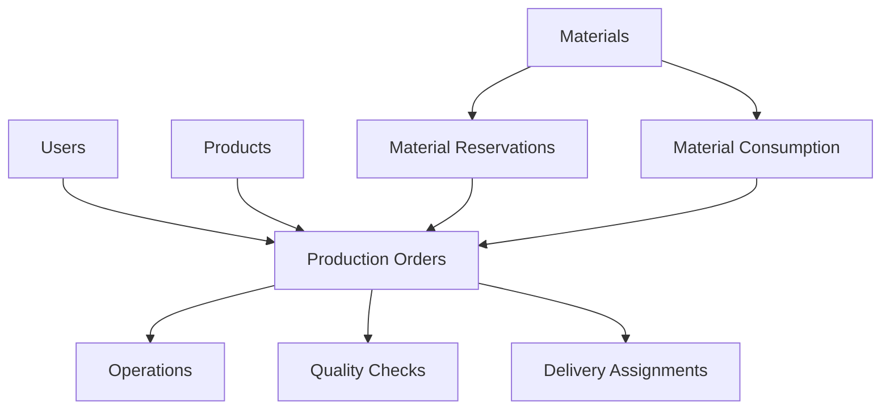

# Technical Documentation

**Audience:** Developers, System Administrators, IT Personnel  
**Purpose:** Technical implementation details, architecture, and development guidelines  
**Last Updated:** January 20, 2025

## 🏗️ System Architecture Overview

### **Technology Stack**
- **Frontend:** Next.js 14 with App Router, React 18, TypeScript
- **Backend:** Next.js API Routes, Server Actions
- **Database:** PostgreSQL with Prisma ORM
- **Authentication:** NextAuth.js with database sessions
- **UI Framework:** Tailwind CSS with shadcn/ui components
- **Deployment:** Docker containerization with standalone builds

### **Architecture Patterns**
- **Role-Based Architecture** - Separate interfaces for each user role
- **Server-Side Rendering** - Optimized performance with SSR
- **Component-Driven Development** - Reusable UI components
- **Type-Safe Development** - Full TypeScript implementation
- **Database-First Design** - Prisma schema as single source of truth

## 📁 Project Structure

### **Root Directory Structure**
```
xgen-mrp/
├── src/                    # Main source code
│   ├── app/               # Next.js App Router pages
│   ├── components/        # React components
│   ├── lib/              # Utility functions and server actions
│   └── types/            # TypeScript type definitions
├── prisma/               # Database schema and migrations
├── public/               # Static assets
├── notes/                # Documentation
└── docker files          # Containerization
```

### **Source Code Organization**

#### **App Directory (`src/app/`)**
```
app/
├── admin/(protected)/     # Admin dashboard and features
├── worker/(protected)/    # Worker interface
├── inspector/(protected)/ # Quality control interface
├── delivery/(protected)/  # Delivery management
├── api/                  # API routes
└── globals.css          # Global styles
```

#### **Components (`src/components/`)**
```
components/
├── ui/                   # Base UI components (shadcn/ui)
├── module/               # Role-specific feature components
│   ├── admin/           # Admin-specific components
│   ├── worker/          # Worker-specific components
│   ├── inspector/       # Inspector-specific components
│   └── delivery/        # Delivery-specific components
├── shared/              # Reusable business components
└── providers/           # Context providers
```

#### **Server Actions (`src/lib/actions/`)**
```
actions/
├── production-order.ts     # Production management
├── material-reservation.ts # Material tracking
├── material-consumption.ts # Material usage
├── inventory-movement.ts   # Stock movements
├── cost-variance.ts        # Cost analysis
├── quality-checks.ts       # Quality management
└── [role]/                 # Role-specific actions
```

## 🗄️ Database Architecture

### **Core Entity Relationships**


### **Key Database Models**

#### **Production Management**
- **ProductionOrder** - Main production entity
- **Operation** - Work center tasks
- **ProductionBatch** - Batch tracking
- **ProductionBOM** - Production-specific BOMs

#### **Material Management**
- **Material** - Material master data
- **MaterialReservation** - Material allocation
- **ProductionMaterialConsumption** - Usage tracking
- **InventoryMovement** - Stock movement audit

#### **Quality Management**
- **QualityCheck** - Quality inspections
- **Inspector** - Quality personnel
- **CostVariance** - Cost analysis

#### **User Management**
- **User** - System users
- **WorkCenter** - Production areas
- **Customer** - Customer information

### **Database Performance Optimizations**
- **Indexing Strategy** - Optimized indexes on frequently queried fields
- **Relationship Optimization** - Efficient foreign key relationships
- **Query Optimization** - Optimized Prisma queries
- **Connection Pooling** - Database connection management

## 🔐 Authentication and Authorization

### **Authentication System**
- **NextAuth.js** - Industry-standard authentication
- **Database Sessions** - Secure server-side session management
- **Role-Based Access** - Granular permission system
- **Session Security** - Secure session handling and validation

### **Authorization Levels**
```typescript
enum UserRole {
  ADMIN     // Full system access
  WORKER    // Production tasks and inventory
  INSPECTOR // Quality control and inspections
  DELIVERY  // Order fulfillment and logistics
}
```

### **Route Protection**
```typescript
// Page-level protection
export const dynamic = 'force-dynamic'

// Action-level protection
const session = await getServerSession(authOptions)
if (!session?.user || session.user.role !== 'ADMIN') {
  throw new Error('Unauthorized')
}
```

## 🔄 Server Actions Architecture

### **Server Actions Pattern**
```typescript
'use server'

export async function actionName(data: InputType): Promise<ResponseType> {
  // 1. Authentication check
  const session = await getServerSession(authOptions)
  if (!session?.user) throw new Error('Unauthorized')
  
  // 2. Input validation
  const validatedData = schema.parse(data)
  
  // 3. Business logic
  const result = await businessLogic(validatedData)
  
  // 4. Database operations
  await database.update(result)
  
  // 5. Revalidate paths
  revalidatePath('/relevant-path')
  
  return result
}
```

### **Key Server Action Categories**

#### **Production Actions**
- `createProductionOrder()` - Create new production orders
- `updateProductionOrderStatus()` - Update order status
- `getProductionOrders()` - Retrieve production data
- `deleteProductionOrder()` - Remove production orders

#### **Material Actions**
- `reserveMaterialsForProduction()` - Reserve materials
- `consumeMaterialForProduction()` - Record consumption
- `adjustMaterialStock()` - Manual stock adjustments
- `getMaterialAvailability()` - Check stock levels

#### **Quality Actions**
- `createQualityCheck()` - Create quality inspections
- `updateQualityCheck()` - Update inspection results
- `getQualityMetrics()` - Retrieve quality data
- `generateQualityReport()` - Create quality reports

## 🎨 UI/UX Architecture

### **Design System**
- **Base Components** - shadcn/ui component library
- **Custom Components** - Business-specific components
- **Consistent Styling** - Tailwind CSS utility classes
- **Responsive Design** - Mobile-first responsive approach

### **Component Patterns**

#### **Page Components**
```typescript
// Standard page layout
export default function PageComponent() {
  return (
    <div className="flex flex-col gap-6 p-8">
      <PageHeader title="Page Title" />
      <StatsCards data={stats} />
      <DataTable data={data} />
    </div>
  )
}
```

#### **Form Components**
```typescript
// Standard form pattern
export function FormComponent() {
  const form = useForm<FormData>({
    resolver: zodResolver(schema),
    defaultValues: defaultValues
  })

  return (
    <Form {...form}>
      <form onSubmit={form.handleSubmit(onSubmit)}>
        <FormFields />
        <FormActions />
      </form>
    </Form>
  )
}
```

### **State Management**
- **Server State** - TanStack Query for server data
- **Client State** - React hooks for local state
- **Form State** - React Hook Form for form management
- **Global State** - Context API for shared state

## 🚀 Performance Optimizations

### **Next.js Optimizations**
- **Static Generation** - Pre-rendered pages where possible
- **Dynamic Rendering** - Server-side rendering for authenticated pages
- **Image Optimization** - Next.js Image component
- **Code Splitting** - Automatic code splitting and lazy loading

### **Database Optimizations**
- **Query Optimization** - Efficient Prisma queries
- **Connection Pooling** - Database connection management
- **Indexing Strategy** - Optimized database indexes
- **Caching Strategy** - Strategic use of caching

### **Frontend Optimizations**
- **Component Memoization** - React.memo for expensive components
- **Virtual Scrolling** - For large data lists
- **Lazy Loading** - Lazy load components and routes
- **Bundle Optimization** - Optimized JavaScript bundles

## 🔧 Development Guidelines

### **Code Standards**
- **TypeScript** - Strict TypeScript configuration
- **ESLint** - Code quality and consistency
- **Prettier** - Code formatting
- **Husky** - Git hooks for quality checks

### **File Naming Conventions**
- **Pages** - `page.tsx`
- **Components** - `PascalCase.tsx`
- **Actions** - `kebab-case.ts`
- **Types** - `kebab-case.ts`

### **Import Organization**
```typescript
// 1. External libraries
import React from 'react'
import { NextPage } from 'next'

// 2. Internal utilities
import { cn } from '@/lib/utils'

// 3. Components
import { Button } from '@/components/ui/button'

// 4. Types
import type { User } from '@/types/user'
```

### **Error Handling**
```typescript
try {
  const result = await businessLogic()
  return { success: true, data: result }
} catch (error) {
  console.error('Context:', error)
  return { success: false, error: 'User-friendly message' }
}
```

## 🐳 Deployment Architecture

### **Docker Configuration**
- **Multi-stage Build** - Optimized Docker images
- **Standalone Build** - Next.js standalone output
- **Environment Variables** - Secure configuration management
- **Health Checks** - Container health monitoring

### **Production Setup**
```dockerfile
FROM node:18-alpine AS base
# Dependencies and build stages
FROM base AS runner
WORKDIR /app
COPY --from=builder /app/public ./public
COPY --from=builder /app/.next/standalone ./
COPY --from=builder /app/.next/static ./.next/static
EXPOSE 3000
CMD ["node", "server.js"]
```

### **Environment Configuration**
- **Development** - Local PostgreSQL + Next.js dev server
- **Production** - Docker containers + standalone build
- **Environment Variables** - Secure configuration management

## 📊 Monitoring and Logging

### **Application Monitoring**
- **Error Tracking** - Comprehensive error logging
- **Performance Monitoring** - Application performance metrics
- **User Activity** - User action tracking and analytics
- **System Health** - Health checks and monitoring

### **Database Monitoring**
- **Query Performance** - Database query optimization
- **Connection Monitoring** - Database connection health
- **Data Integrity** - Data consistency checks
- **Backup Monitoring** - Database backup verification

### **Security Monitoring**
- **Access Logs** - User access and activity logs
- **Authentication Events** - Login and security events
- **Data Changes** - Audit trail of data modifications
- **Security Alerts** - Automated security notifications

## 🔒 Security Implementation

### **Data Protection**
- **Input Validation** - Zod schema validation
- **SQL Injection Prevention** - Prisma ORM protection
- **XSS Prevention** - React built-in protection
- **CSRF Protection** - NextAuth.js built-in protection

### **Access Control**
- **Role-Based Access** - Granular permission system
- **Session Security** - Secure session management
- **API Security** - Protected API endpoints
- **Data Encryption** - Sensitive data encryption

### **Audit and Compliance**
- **Activity Logging** - Complete user activity logs
- **Data Audit Trail** - Changes tracked with timestamps
- **Compliance Reporting** - Regulatory compliance reports
- **Security Audits** - Regular security assessments

## 🧪 Testing Strategy

### **Testing Levels**
- **Unit Tests** - Individual function testing
- **Integration Tests** - Component integration testing
- **End-to-End Tests** - Complete workflow testing
- **Performance Tests** - Load and performance testing

### **Testing Tools**
- **Jest** - Unit testing framework
- **React Testing Library** - Component testing
- **Playwright** - End-to-end testing
- **Prisma Testing** - Database testing utilities

## 📚 API Documentation

### **RESTful API Endpoints**
```
GET    /api/production-orders     # List production orders
POST   /api/production-orders     # Create production order
GET    /api/production-orders/:id # Get specific order
PUT    /api/production-orders/:id # Update order
DELETE /api/production-orders/:id # Delete order
```

### **Server Actions API**
```typescript
// Type-safe server actions
export async function getProductionOrders(
  filters: ProductionOrderFilters
): Promise<ProductionOrder[]>

export async function createProductionOrder(
  data: CreateProductionOrderInput
): Promise<ProductionOrder>
```

## 🔗 Integration Capabilities

### **External System Integration**
- **REST APIs** - Standard REST API endpoints
- **Webhooks** - Event-driven integrations
- **Data Export** - CSV, Excel, JSON export formats
- **Data Import** - Bulk data import capabilities

### **Third-Party Integrations**
- **ERP Systems** - Enterprise resource planning integration
- **Accounting Systems** - Financial system integration
- **Shipping Systems** - Logistics and shipping integration
- **Quality Systems** - Quality management system integration

---

**This technical documentation provides the foundation for understanding, maintaining, and extending the XGen MRP system. Follow these guidelines for consistent, maintainable, and scalable development.**